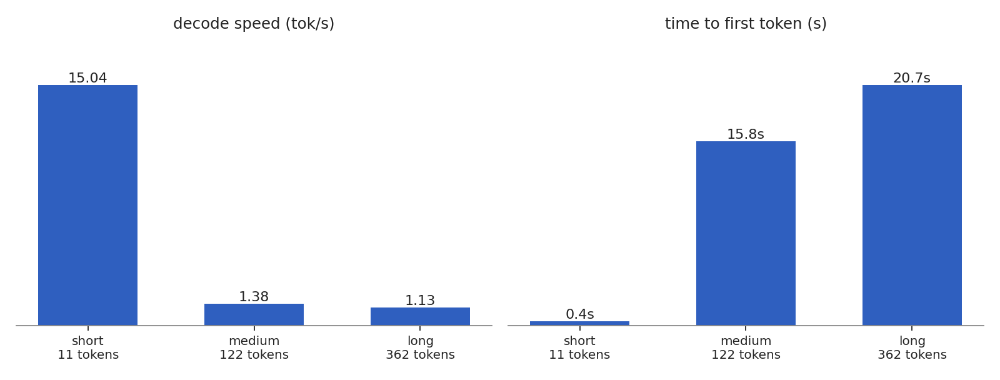

# qwen3.8-flash-next

runs qwen3.8-flash-next on an m3 max. the model is a 180b mixture-of-experts and doesn't fit in ram, so the routed experts stay on the ssd and get read in as the router needs them. this is the python runtime. the c port in `c/` has no numbers yet.

## benchmark



m3 max, 36 gb, 8 gib expert cache, mlx 0.32.2. medians of 5 runs per prompt, 4 generated tokens. raw data in `artifacts/benchmark_results.json`.

short prompts decode at about 15 tok/s. medium and long prompts run at 1.1 to 1.4 tok/s because they need more experts than the cache holds.

one longer run: 64 tokens from a 45-token prompt, 1.33 tok/s, 52.7 GiB read from disk.

```sh
python -m colibri_runtime.cli --model "$MODEL_DIR" --expert-budget-gib 8 --ple-budget-gib 1 --mlx-cache-gib 1 --mlx-memory-gib 28 --io-workers 6 --expert-prefetch 2 --ple-prefetch 8 benchmark --prompt "Write a detailed explanation of how sparse mixture-of-experts inference streams experts from SSD on Apple Silicon. Cover routing, cache eviction, asynchronous prefetch, and the memory and latency tradeoffs in at least 200 words." --max-tokens 64 --runs 1
```

`MODEL_DIR` is the local 4-bit model directory.

## tests

29 python tests with `pytest`.
